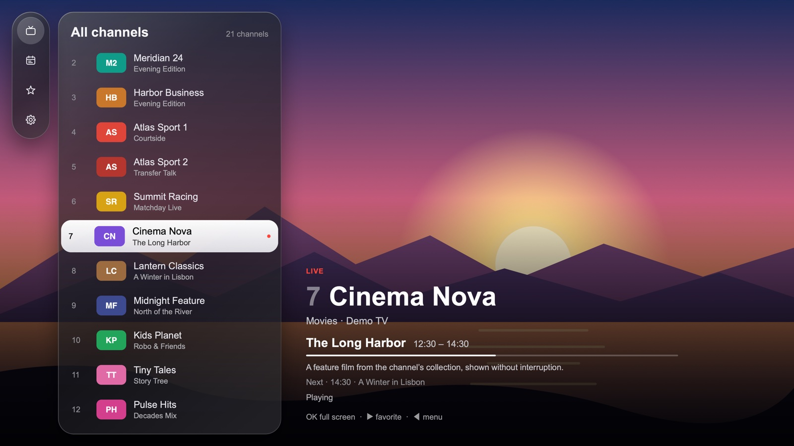
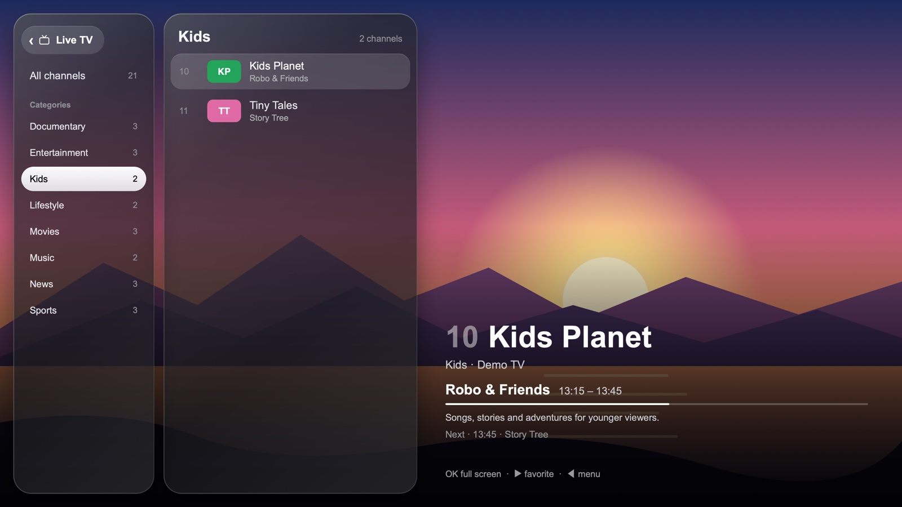
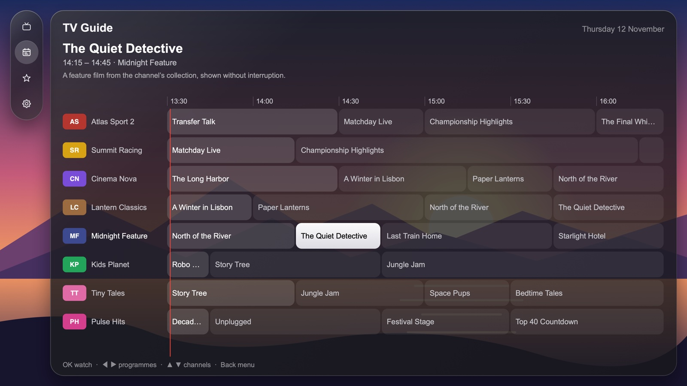
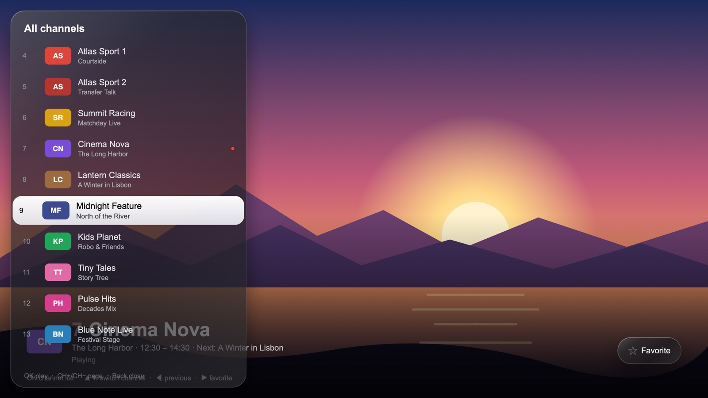
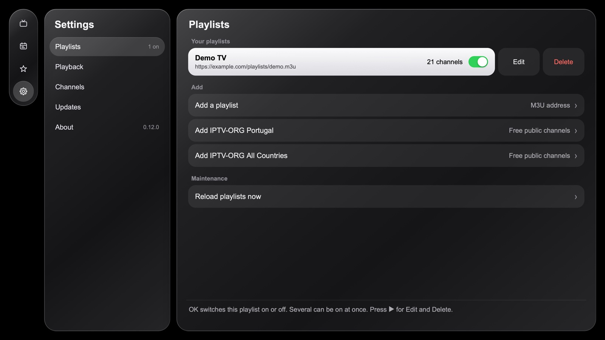
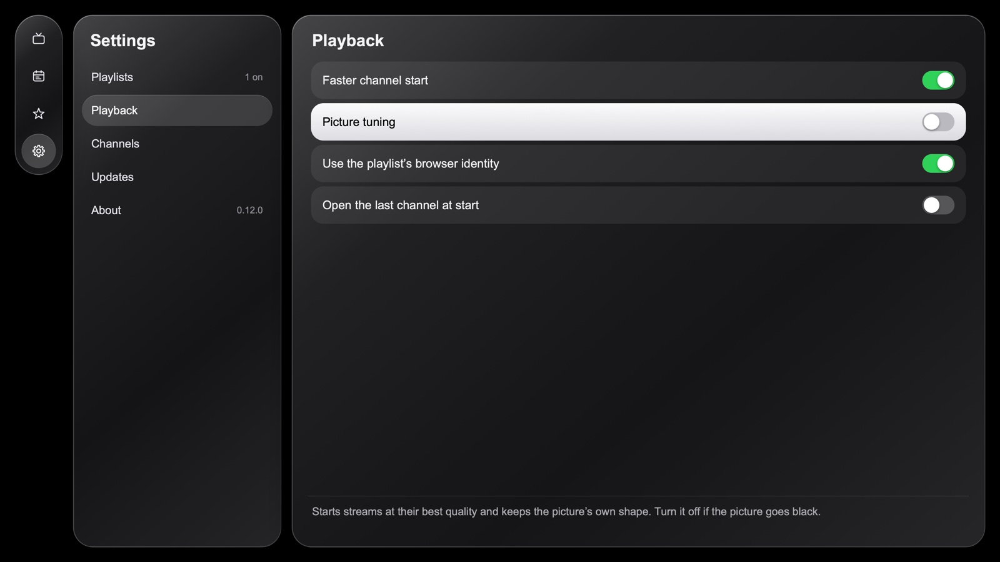
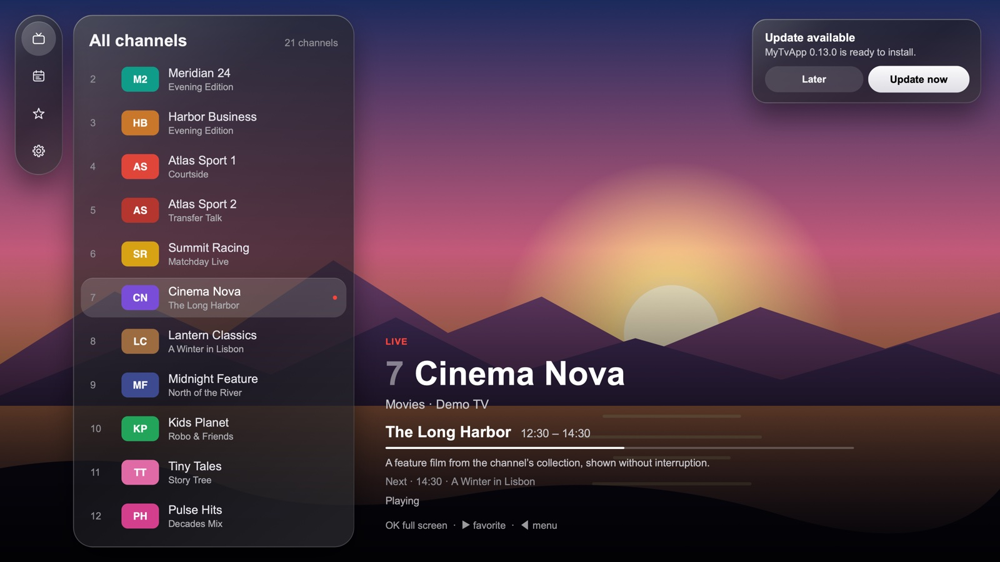

# MyTvApp

A live TV player for Samsung Smart TVs. It plays the channels of your M3U playlists, shows what is on now and next, and is driven entirely with the TV remote.



**[Download the latest package](https://github.com/miglworld/MyTvApp/releases/latest)** · [Changelog](CHANGELOG.md) · [Security](SECURITY.md) · [Why it is built this way](docs/decisions.md)

> The screenshots use a demo playlist with invented channels and programmes, and a drawn picture in place of video.

## Contents

- [What it does](#what-it-does)
- [A tour of the app](#a-tour-of-the-app)
- [Remote keys](#remote-keys)
- [Installing](#installing)
- [Updates](#updates)
- [Programme guide](#programme-guide)
- [Development](#development)
- [Credits and license](#credits-and-license)

## What it does

| | |
|---|---|
| **Your playlists** | Any number of M3U/M3U8 playlists, each switched on or off. Two free iptv-org playlists can be added with one press. |
| **Live TV** | The channel you rest on plays behind the whole screen; the menu and the channel list float over it as glass panels. |
| **TV Guide** | A grid of channels and times for the next two days, for channels the guide covers. |
| **Now and next** | The programme that is on, its times, progress and description, in the list, the caption and the full-screen bar. |
| **Favorites** | Star a channel; favorites have their own list. |
| **Three players** | Samsung's own player first, then the browser's, then [hls.js](https://github.com/video-dev/hls.js/). If one cannot show a channel, the next is tried. |
| **Self-update** | The app downloads new versions from this repository and asks before installing them. A version that does not start is discarded. |
| **Made for the remote** | Arrow keys, OK and Back everywhere, plus channel up/down, number keys, previous channel and play/pause. |

## A tour of the app

### Live TV

The app opens on Live TV. The channel list is on the left; the channel it rests on starts playing behind everything after a moment. The caption shows the channel, the programme that is on, how far along it is, and what follows.

Channels a playlist marks as unreliable, and channels that did not play last time on your TV, are shown darker.

### The menu

Left opens the menu. The main menu has **Live TV**, **TV Guide**, **Favorites** and **Settings**. Live TV opens its own menu in the same place: **All channels**, then every category of your playlists. Moving through the categories changes the channel list at once.



While the remote is in the channel list, the menu folds into a small capsule of icons so the picture has the room.

### TV Guide

Channels down the left, time across. The red line is the present; programmes that are on now are brighter. The details of the highlighted programme are at the top. OK on a programme that is on plays its channel.



### Full screen

OK on a channel hides the panels. The stream is not restarted, so this is instant. Right or INFO shows the info bar: channel, programme, picture size and the Favorite button.


OK opens the channel list over the picture, to change channel without leaving full screen.



### Settings

Five sections on the left; the rows of the chosen section on the right. Each row is a switch, a value or an action, and a sentence under the rows explains the one the remote is on.



| Section | What is there |
|---|---|
| **Playlists** | Your playlists with their channel counts, each with a switch, Edit and Delete. Add a playlist by address, add an iptv-org playlist, reload all playlists. |
| **Playback** | Faster channel start, picture tuning, the playlist's browser identity, open the last channel at start. |
| **Channels** | How channels marked "Geo-blocked" or "Not 24/7" are shown (dimmed, hidden, as normal); forget channels marked as not playing; counts. |
| **Updates** | Automatic updates, check now, developer mode. |
| **About** | Version, where the app runs from, the TV's software, when the guide was built, the last update check, the last error, and the diagnostics list. |



The playlist address field opens Samsung's keyboard, so you can also type it from your phone with the SmartThings app.

### Updates

When a new version has been downloaded, a notice appears in the corner. **Update now** restarts the app into it; **Later** installs it the next time the app starts. The notice waits while a channel is full screen.



## Remote keys

**Live TV**

| Key | Action |
|---|---|
| Up / Down | Move through the menu or the channel list |
| Right, OK on Live TV | Open Live TV's menu: All channels and the categories |
| Right, OK on All channels, a category or Favorites | Go into the channel list |
| Left, Back in the list | Open the menu |
| Left, Back in Live TV's menu | Back to the main menu |
| OK in the list | Full screen |
| Right in the list | Add or remove the favorite |
| CH+ / CH- | Page through the list |
| Back in the main menu | Exit the app (asks first) |

**TV Guide**

| Key | Action |
|---|---|
| Left / Right | Previous / next programme of the channel (the grid moves on in time) |
| Up / Down, CH+ / CH- | Other channels, at the same time of day |
| OK | Play the channel, when the programme is on now |
| Back, Left at the start | Open the menu |

**Full screen**

| Key | Action |
|---|---|
| OK | Open the channel list over the picture |
| Up / Down, CH+ / CH- | Next / previous channel |
| Left, PRE-CH | The channel you watched before |
| Right, INFO | Info bar with the Favorite button (OK toggles it) |
| 0-9 | Jump to a channel number (after 2 s, or press OK) |
| Play/Pause | Pause or resume |
| Back | Close the list or info bar, then leave full screen |

## Installing

You install the package once. After that the app updates itself.

**With TizenBrew (the simple way)**

1. On the TV, turn on Developer Mode, set its Host PC IP to your computer's IP, and reboot.
2. In the TizenBrew Installer, choose **Install from GitHub** and enter `miglworld/MyTvApp`. It takes the package from the latest release and signs it with your Samsung certificate.
3. Set the Host PC IP back to `127.0.0.1`, reboot, and open MyTvApp from the TV's Apps list.

**With the Tizen tools**

1. Download `MyTvApp.wgt` from the [latest release](https://github.com/miglworld/MyTvApp/releases/latest). It is **unsigned**: sign it with your own Samsung certificate (`tizen package -t wgt -s <profile>`).
2. Install it:

```bash
sdb connect <tv-ip-address>
tizen install -n MyTvApp.wgt -t <device-id>
```

Installing over an earlier version keeps your playlists and favorites. If a copy signed with a different certificate is already installed, uninstall it first, or the install fails with "Author certificate not match".

<details>
<summary>As a TizenBrew module (to try the interface only)</summary>

A TizenBrew module runs as a plain web page without Samsung's TV APIs. It only has the browser players, which most free IPTV servers refuse, so use it to try the interface, not to watch.

1. In TizenBrew, open the **Module Manager** and choose **Add GitHub Module**.
2. Enter `miglworld/MyTvApp@main`. Keep the `@main`: without it the CDN serves the latest release tag, which can be older than `main`.
3. Launch MyTvApp from TizenBrew.

Module files come through the jsDelivr CDN, which caches branch files for up to 12 hours. The module keeps its own playlists and favorites, separate from an installed copy.

</details>

## Updates

- The package always starts from its own files (`index.html`, `js/boot.js`).
- A few seconds after the start, the app asks GitHub which commit the `main` branch points at and reads the version there. If it is newer, it downloads the app's page, stylesheet and script **from that one commit** and keeps them in the TV's storage. Files fetched by branch name can be minutes out of step with each other; a commit cannot.
- Before storing an update, the app checks that the script is the announced version and that the page has every part the script uses.
- The corner notice then offers **Update now** or **Later**.
- **An update that does not start is thrown away** and not downloaded again by itself; the package's own version runs instead. The worst case is one failed start. "Check for updates now" in Settings may try that version once more.
- If the app script fails, the error is shown in a red box at the bottom of the screen and kept in Settings, under About.

A new package is still needed when `config.xml`, `js/boot.js` or `lib/hls.min.js` changes.

### Developer mode

**Developer mode** (Settings, Updates, off by default) makes the TV follow the `dev` branch instead of `main`, so a test version can be tried on the TV before it is released.

- With it on, the TV takes whatever version the `dev` branch holds, as long as it differs from the one running and is newer than the installed package.
- A test version that does not start is discarded like any other update.
- Turning it off forgets the test version: the next start runs the installed package's version, which then updates to the released one.

## Programme guide

The TV does not read a full programme guide itself: one country's guide is tens of MB. Instead a job in this repository (`.github/workflows/guide.yml`, every four hours) runs `scripts/build-guide.js`, which downloads the guide feeds listed in `guide/config.json`, keeps only the channels of the playlists listed there and the next 48 hours, and publishes the result (about 300 KB) as `guide.json` on the `guide` branch. The TV downloads that file and refreshes it when its copy is older than three hours.

- `guide/config.json`: `playlists` (whose channels to keep), `feeds` (XMLTV guide files), `hours`.
- Channels are matched by the playlist's `tvg-id` without its `@...` ending, in lower case.
- The job only downloads HTTPS addresses on the hosts listed in `ALLOWED_HOSTS` in `scripts/build-guide.js`. A feed on a new server means adding its host there.
- The guide data comes from a third-party feed (iptv-epg.org at present) and is republished here in trimmed form. A channel the feed does not cover has no guide, and only playlists in `guide/config.json` get one.
- To build it by hand: `node scripts/build-guide.js out/guide.json`. To run the job now: `gh workflow run guide.yml`.

## Development

### Project structure

```
config.xml              Tizen widget manifest (app id, privileges, start page)
index.html              The app and the package's start page: all screens
css/style.css           All styling
js/boot.js              Starts js/main.js, or a newer downloaded copy of the app
js/main.js              App logic: menu, lists, guide, playback, settings, updates
lib/hls.min.js          hls.js 1.6.19, bundled (license: lib/hls.LICENSE)
icon.png                App icon referenced by config.xml
package.json            Version and TizenBrew module info
guide/config.json       Which playlists and guide feeds the programme guide is built from
scripts/build-wgt.sh    Builds the unsigned MyTvApp.wgt
scripts/build-guide.js  Builds the small programme guide (run by GitHub on a schedule)
scripts/check.sh        Checks run before every merge (also by GitHub on each pull request)
scripts/test.js         Tests for the playlist reader, list window and guide lookup
scripts/test-guide.js   Tests for the guide builder
scripts/screenshots/    Retakes the README screenshots from a demo setup
docs/decisions.md       Why the app is built the way it is
```

There is no build step for the app itself: `index.html` runs as it is, in a desktop browser too (`python3 -m http.server`, then open `index.html`; the Samsung player is not available there).

### Checks

TVs update themselves from `main`, so `main` is protected: every pull request is checked by GitHub (`.github/workflows/check.yml`) and scanned by CodeQL, and is only merged when the check is green. Run the same checks locally with:

```bash
./scripts/check.sh
```

They verify that the scripts parse, that the version is the same in all four places, that the files self-update relies on are intact, that the security rules in [SECURITY.md](SECURITY.md) hold, that the tests pass, and (in a pull request) that the version went up whenever the app's own files changed.

### Releasing a change

1. Bump the version in **four places**, to the same value: `package.json`, `config.xml`, `APP_VERSION` in `js/main.js`, and `BUNDLED_VERSION` in `js/boot.js`.
2. Add a line to [CHANGELOG.md](CHANGELOG.md).
3. Optional: try it on the TV first. Push the work to the `dev` branch (`git push origin HEAD:dev --force-with-lease`), and on a TV with Developer mode on choose "Check for updates now".
4. Open a pull request, wait for the check, and merge into `main`. Installed TVs update themselves on the next start. Afterwards bring `dev` level with `main` again.
5. For a new package (first installs, or a change to `config.xml`, `js/boot.js` or `lib/hls.min.js`), build it and attach it to a GitHub release:

```bash
./scripts/build-wgt.sh
gh release create v<version> MyTvApp.wgt --title "MyTvApp <version>"
```

`scripts/build-wgt.sh` refuses to build if the four versions differ.

### Building a signed package with the Tizen CLI

Needs [Tizen Studio](https://developer.samsung.com/smarttv/develop/getting-started/setting-up-sdk.html) (or its CLI tools) with the `tv-samsung` platform, and a signing profile (`tizen security-profiles list`).

```bash
tizen build-web -- .
tizen package -t wgt -s <your-security-profile> -- .buildResult
```

This produces `.buildResult/MyTvApp.wgt`.

### Screenshots

The README pictures are taken from the app itself, running against a demo setup: invented channels and programmes, a drawn picture in place of video, and a stand-in for the Samsung player. To retake them after an interface change (macOS only; it uses the system web view):

```bash
./scripts/screenshots/capture.sh
```

On a TV the glass panels look as they do in these pictures: clear rather than frosted, because the Samsung player draws its picture outside the page, where the app cannot blur it.

### Compatibility notes

- TV browsers are old: the CSS avoids Grid, `gap`, `aspect-ratio` and `inset`, and the JavaScript is plain ES5.
- Remote keys are read by `keyCode`, as in Samsung's own samples.
- The app id in `config.xml` (`wAKjt4yhqx.TVapp`) is what the TV uses to recognise the app. Changing it makes the TV treat it as a different app, with empty playlists and favorites.
- Playback options a playlist may carry: a user agent (`#EXTVLCOPT:http-user-agent=...` or a `user-agent` attribute) is passed to the Samsung player; a `http-referrer` cannot be sent by a TV app.

### Network dependence

Playlists are downloaded from their address the first time and then kept on the TV; later starts use the stored copy and refresh it in the background when it is older than 6 hours. A download that hangs is stopped after 15 seconds. Channels stream from their own servers, and many free iptv-org streams are offline or restricted to certain countries at any given time.

## Credits and license

- MyTvApp started from [KaashDev/TVapp](https://github.com/KaashDev/TVapp) and has since been rewritten.
- [hls.js](https://github.com/video-dev/hls.js/) is bundled under its own license (`lib/hls.LICENSE`).
- Preset playlists come from [iptv-org](https://github.com/iptv-org/iptv); the programme guide is built from [iptv-epg.org](https://iptv-epg.org/).
- App icon: "Live TV" from the Noun Project.

The original project has no license file, so this repository does not carry an open-source license either.
