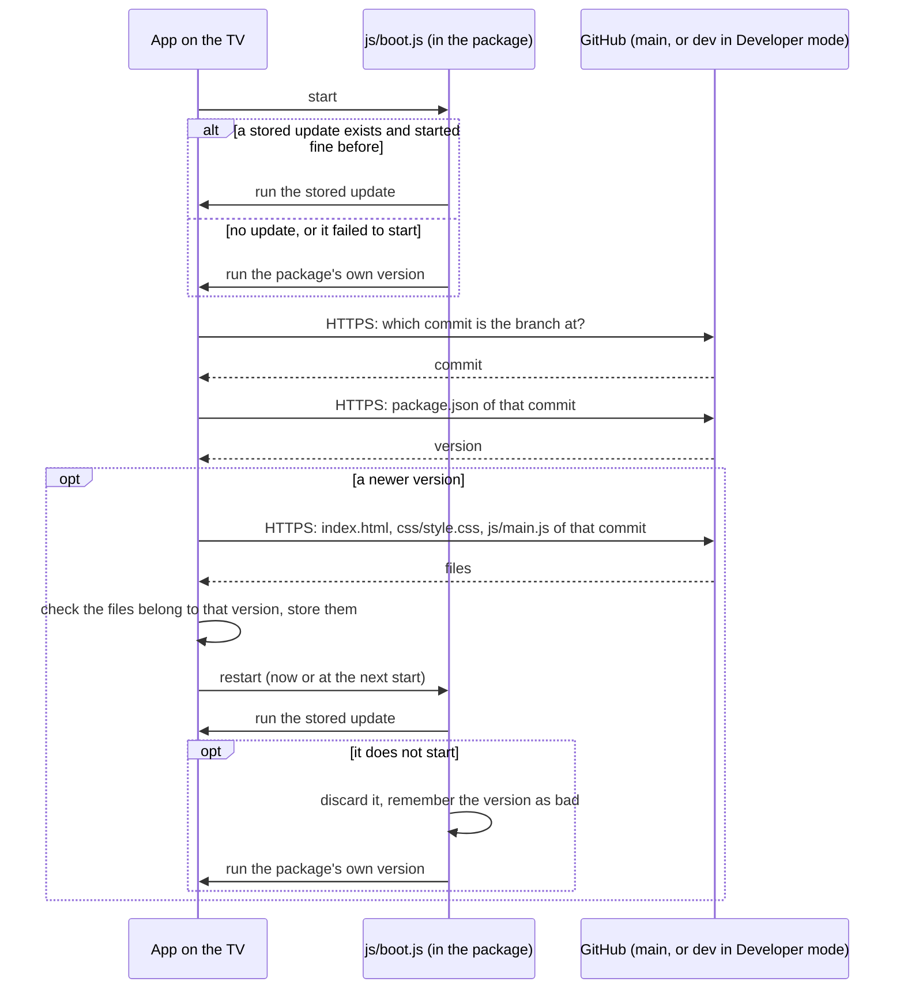

# Security

How MyTvApp is exposed, what protects it, and what to do when something goes wrong.

## Reporting a problem

Open an issue on this repository. If it should not be public, use GitHub's "Report a vulnerability" on the Security tab.

## What the app trusts

| Source | Trusted? | Why it matters |
|---|---|---|
| The installed package (`index.html`, `js/boot.js`, `js/main.js`, `lib/hls.min.js`) | Yes | It is what you installed and signed. |
| This repository's `main` branch | Yes | The app downloads newer versions of itself from it and runs them. |
| This repository's `dev` branch | Only with Developer mode on | Same as above, for test versions. |
| Playlists (any URL you add) | **No** | Names, groups, logos and stream addresses are written by someone else. |
| The programme guide (`guide.json` on this repository's `guide` branch) | As data only | It is built by this repository's own job, but from a third-party feed: titles and descriptions are written by someone else. |
| Stream and logo servers | **No** | They see the TV's IP address and can send anything back. |

## The main risks

```
MyTvApp threats
├─ Code reaching the TV
│  ├─ Self-update
│  │  ├─ GitHub account or repository taken over
│  │  │  ├─ Malicious version merged into main
│  │  │  └─ Malicious version pushed to dev (Developer mode only)
│  │  └─ Broken version merged by mistake
│  │     ├─ Does not start (discarded automatically)
│  │     └─ Starts but misbehaves (needs a fixed version)
│  └─ Package
│     ├─ Tampered .wgt from somewhere other than this repository's releases
│     └─ Tampered bundled library
├─ Untrusted content
│  ├─ Playlist text
│  │  ├─ Markup or script in names and groups
│  │  ├─ Stream addresses that are not streams (file:, javascript:, data:)
│  │  └─ Oversized playlist (memory and storage)
│  └─ Logos and streams
│     ├─ Tracking of the TV's IP address
│     └─ Malformed media
└─ Data on the TV
   ├─ Playlist URLs that contain a username and password
   │  ├─ Shown in Settings
   │  └─ Stored unencrypted in the app's storage
   └─ Diagnostics list (channel and playlist names, errors)
```

## What protects against them

**Untrusted playlist content**
- Text from playlists is only ever put on screen as text (`textContent`), never as markup. `scripts/check.sh` fails the build if `eval`, `new Function`, `document.write`, `insertAdjacentHTML` or a non-empty `innerHTML` appears in the app script.
- Only `http`, `https`, `rtmp(s)`, `rtsp`, `rtp`, `udp` and `mms` addresses become channels. Logos must be `http` or `https`.
- Playlists over 40 MB are refused.
- A user agent given by a playlist is handed to the player only as one line of printable characters, at most 300 long, so it cannot add request headers of its own.
- `scripts/test.js` contains hostile-playlist cases.

**Self-update**
- Updates come over HTTPS from exactly two addresses, both for this repository: GitHub's commit lookup (which commit `main`, or `dev` in Developer mode, points at) and the files of that commit. `scripts/check.sh` fails if any other address appears. The address override used for testing only works on `localhost`.
- All files of an update come from one commit, and the app checks that the script is the announced version and that the page has everything the script uses before it stores them.
- The start-up script (`js/boot.js`) is part of the package and cannot be replaced by an update. It contains no network address.
- An update that does not start is discarded and never downloaded again.
- Every pull request is checked (scripts parse, versions match, security rules, tests) and scanned by CodeQL before it can reach `main`.



**Package**
- `lib/hls.min.js` is the official hls.js 1.6.19 build; `scripts/check.sh` verifies its SHA-256.
- The package is unsigned in the release and signed on installation with your own Samsung certificate. Only install packages from this repository's releases.

## What is not protected

- **The GitHub account is the key to the TV.** Anyone who can push to `main` can run code in the app on every TV that has it installed. The update is not signed separately. Protect the account with two-factor authentication, and keep `main` protected so that changes need a pull request with a passing check.
- **Developer mode trusts the `dev` branch**, which is not protected. Keep it off except while testing.
- Playlist URLs with credentials are stored unencrypted on the TV and are visible in Settings.
- Streams over plain `http` can be read and altered on the network. That is the playlist's choice, not the app's.
- `config.xml` allows the app to reach any address (`access origin="*"`), which arbitrary playlists need. It also allows navigation to any address (`allow-navigation`), which the app does not use; tightening it needs a test on a TV first.

## If a bad version reaches TVs

1. **Stop it spreading.** Revert the change on `main` and raise the version number in all four places (a version that is not higher is ignored by TVs). Merge it. TVs see it at their next start.
2. **TVs recover on their next start.** A version that did not start has already been discarded on its own. A version that starts but misbehaves is replaced by the fixed one.
3. **A TV that cannot reach Settings** (for example a bad version that hangs after starting): uninstall and reinstall the package from the latest release. This clears saved playlists and favorites.
4. **A TV that can reach Settings:** turning "Automatic updates" off returns it to the package's own version at the next start.
5. **If the account was compromised:** change the password, revoke sessions and tokens, check `main`, `dev`, the releases and the Actions workflows for changes you did not make, then publish a clean higher version and a clean release.
6. Afterwards, write down what happened in `CHANGELOG.md` and add a check or test that would have caught it.
